# DevOps Exercise 10: Multi-Node Kubernetes Cluster with Multiple Applications and ReplicaSets

## Objective

Set up a **3-node Minikube cluster** and deploy two Python Flask microservices of an e-commerce platform on it: a **Product Catalog** service (2 replicas) and a **Shopping Cart** service (3 replicas). Pod anti-affinity rules ensure that the replicas of each service are spread across different nodes, so the services stay available even if one node fails. Both services are exposed through NodePort Services and tested with `curl` and the browser.

## Files in this folder

| File | Purpose |
|------|---------|
| `product_catalog.py` | Flask app for the Product Catalog service (`GET /products`) |
| `shopping_cart.py` | Flask app for the Shopping Cart service (`GET /cart`, `POST /cart`) |
| `Dockerfile.product` | Dockerfile for the Product Catalog image |
| `Dockerfile.shopping` | Dockerfile for the Shopping Cart image |
| `product_catalog_deployment.yaml` | Deployment with 2 replicas and pod anti-affinity |
| `shopping_cart_deployment.yaml` | Deployment with 3 replicas and pod anti-affinity |
| `product_catalog_service.yaml` | NodePort Service for the Product Catalog |
| `shopping_cart_service.yaml` | NodePort Service for the Shopping Cart |

## Steps Performed

### 1. Cleaned up the old cluster and created a 3-node Minikube cluster

Stopped and deleted the existing single-node Minikube cluster (`minikube stop`, `minikube delete`). Then created a new multi-node cluster under the profile `devops-multinode` (`minikube start --nodes 3 -p devops-multinode --force`). The `--force` flag was needed because the Docker driver was being run as root inside WSL. Minikube created the control-plane node and the other nodes, using the Docker driver, Kubernetes v1.37.0 and containerd as the container runtime.

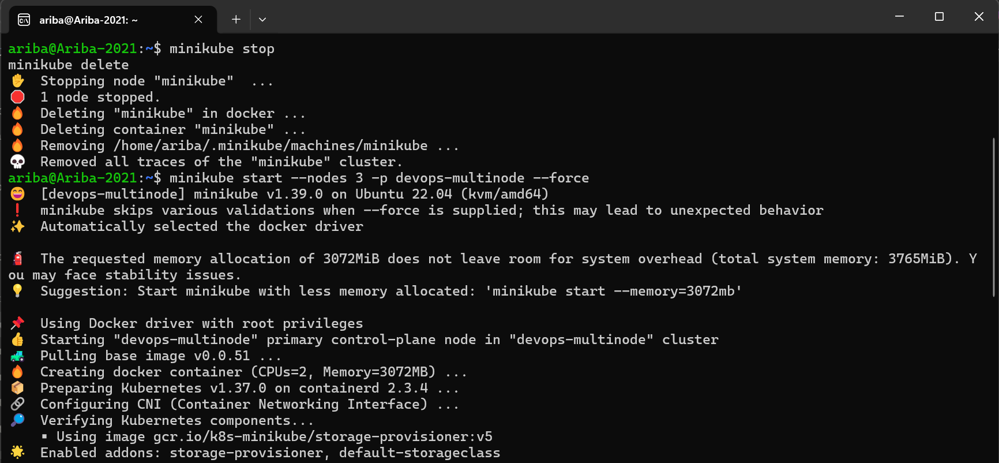

### 2. Verified the 3 nodes and enabled the registry add-on

Ran `kubectl get nodes` and confirmed that all three nodes (`devops-multinode`, `devops-multinode-m02`, `devops-multinode-m03`) were in the `Ready` state. Then enabled the registry add-on for the profile (`minikube -p devops-multinode addons enable registry`), which is the approach used to share images between nodes in a multi-node setup (as `eval $(minikube docker-env)` cannot be used here).

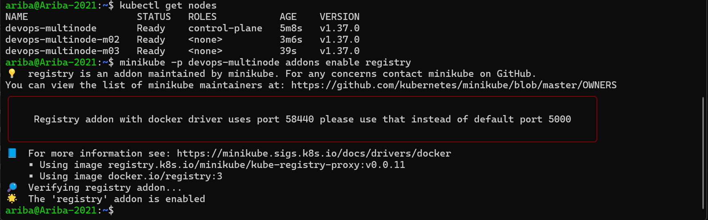

### 3. Created the application and Dockerfile files

Created a working folder `~/exercise10` and wrote the source files: `product_catalog.py` and `shopping_cart.py` (Flask apps listening on port 80), plus `Dockerfile.product` and `Dockerfile.shopping` (based on `python:3.9-slim`, installing Flask and running the respective app).

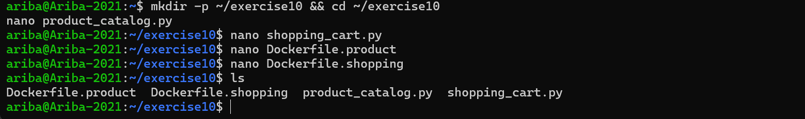

### 4. Built the Docker images and loaded them into the cluster

Built both images locally (`docker build -t product-catalog:latest -f Dockerfile.product .` and `docker build -t shopping-cart:latest -f Dockerfile.shopping .`) and loaded them into the cluster with `minikube -p devops-multinode image load`.

The nodes run containerd instead of Docker, so the `docker images` check over SSH did not work. Instead, the images were verified with `minikube image ls` and with `crictl images` on each of the three nodes. Both `product-catalog:latest` and `shopping-cart:latest` were present on all three nodes, which is required because the Deployments use `imagePullPolicy: Never`.

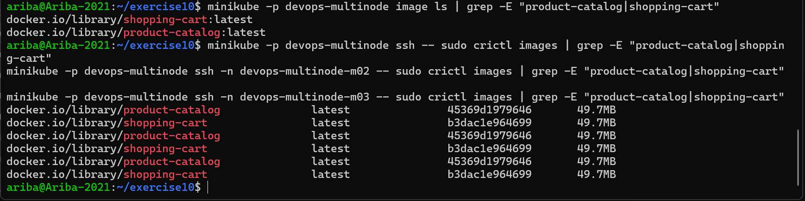

### 5. Deployed both applications and checked pod distribution

Wrote `product_catalog_deployment.yaml` (2 replicas) and `shopping_cart_deployment.yaml` (3 replicas), both with a `podAntiAffinity` rule on `kubernetes.io/hostname` so that no two replicas of the same app can run on the same node. The shopping cart manifest was corrected to use the `default` namespace so it matches its Service. Applied both with `kubectl apply -f`.

`kubectl get pods -o wide` showed all 5 pods `Running` (1/1) and spread across the nodes:

- product-catalog: `devops-multinode-m02` and `devops-multinode-m03`
- shopping-cart: `devops-multinode`, `devops-multinode-m02` and `devops-multinode-m03`

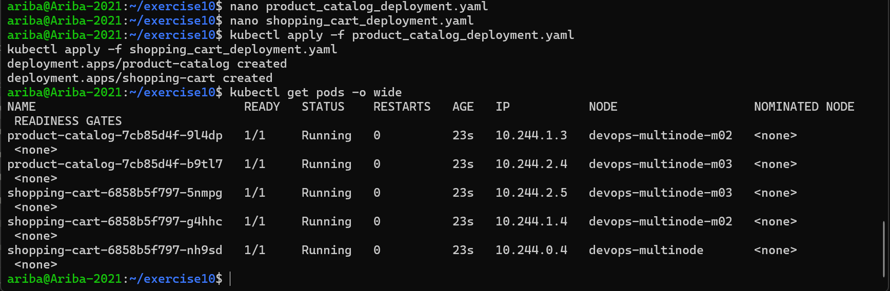

### 6. Exposed the applications with NodePort Services

Created `product_catalog_service.yaml` and `shopping_cart_service.yaml` (type NodePort, port 80 to target port 80) and applied them. Re-checked the pods (`kubectl get pods -o wide`) and listed the Services (`kubectl get svc`), which showed `product-catalog-service` on NodePort 31223 and `shopping-cart-service` on NodePort 31652.

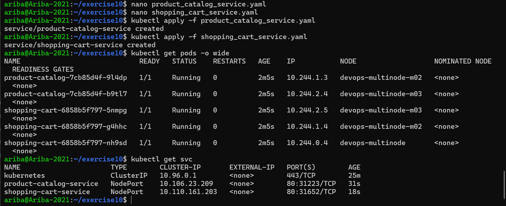

### 7. Accessed the Product Catalog service

Ran `minikube -p devops-multinode service product-catalog-service` in a separate terminal. Because the Docker driver is used on Linux, Minikube opened a tunnel and printed a local URL: `http://127.0.0.1:38407`. The terminal had to stay open for the tunnel to keep running.

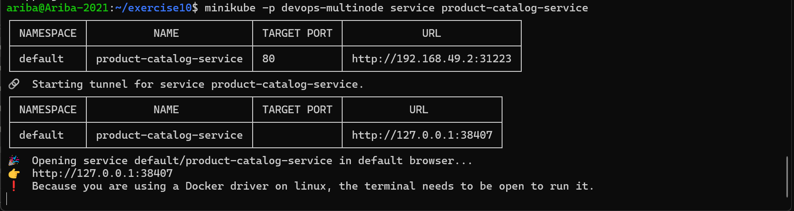

### 8. Accessed the Shopping Cart service

In another terminal, ran `minikube -p devops-multinode service shopping-cart-service`, which created a tunnel at `http://127.0.0.1:41967`.

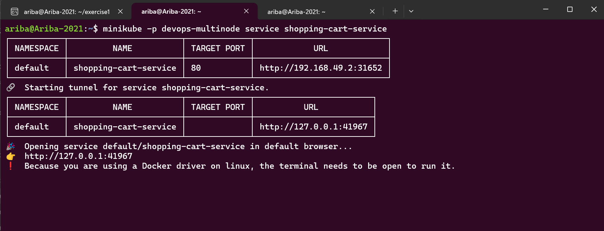

### 9. Tested both services with curl

From a third terminal, tested the services using the tunnel URLs:

- `curl http://127.0.0.1:38407/products` returned the list of 3 products (Laptop, Phone, Headphones).
- `curl http://127.0.0.1:41967/cart` returned an empty cart `[]`.
- `curl -X POST http://127.0.0.1:41967/cart -H "Content-Type: application/json" -d '{"id": 1, "name": "Laptop", "quantity": 1}'` added an item and returned the updated cart `[{"id":1,"name":"Laptop","quantity":1}]`.

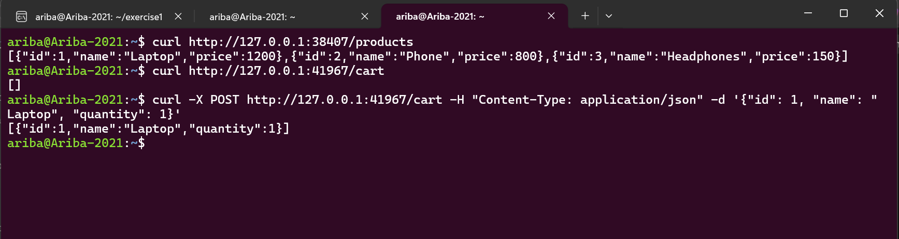

### 10. Verified the Product Catalog in the browser

Opened `http://127.0.0.1:38407/products` in the browser and confirmed that the product list (Laptop 1200, Phone 800, Headphones 150) was returned as JSON.

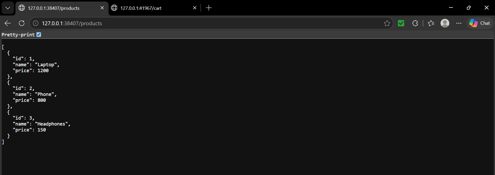

### 11. Verified the Shopping Cart in the browser

Opened `http://127.0.0.1:41967/cart` in the browser and confirmed that the Shopping Cart service responded with an empty cart (`[]`) before any item was added.

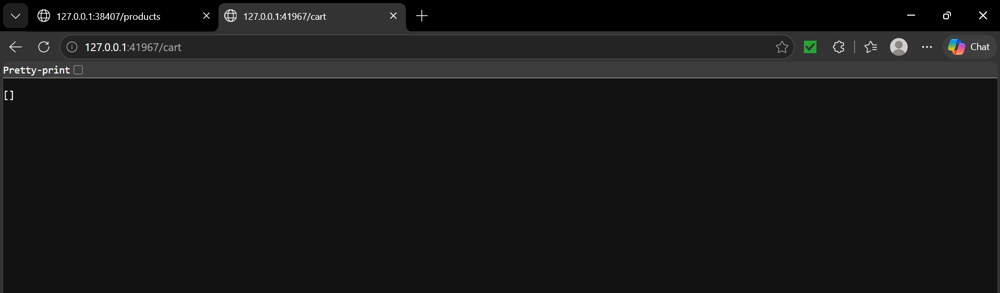

## Summary

Deployed two Python Flask applications (Product Catalog with 2 replicas and Shopping Cart with 3 replicas) on a 3-node Minikube cluster. Pod anti-affinity ensured that the replicas of each application were scheduled on different nodes, which improves availability and fault tolerance: if one node fails, the other nodes still serve the application. Both services were exposed with NodePort Services and tested successfully using `curl` and the browser.
