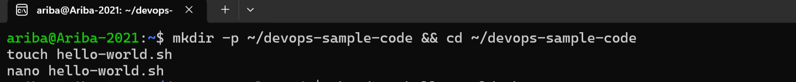
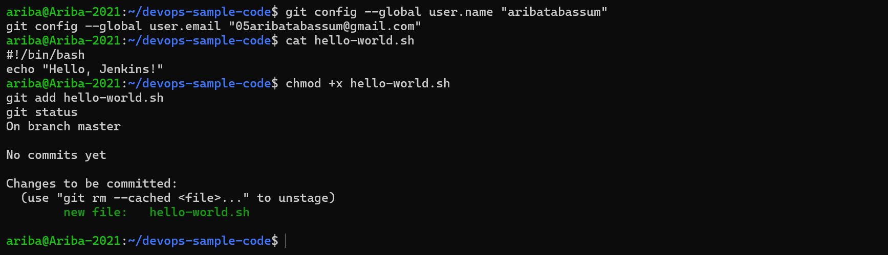
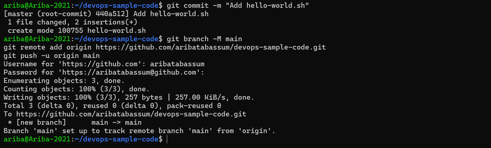
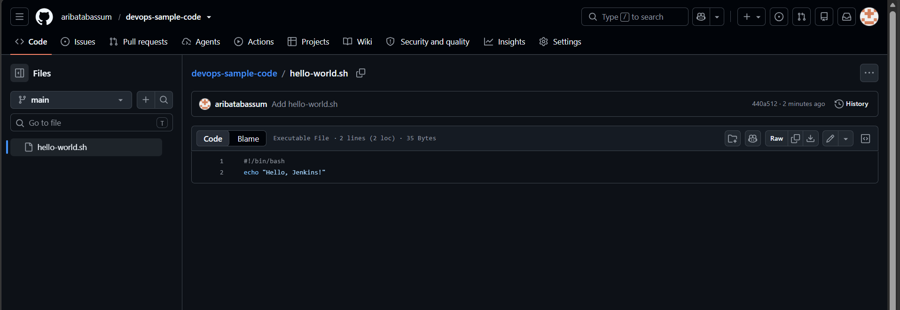
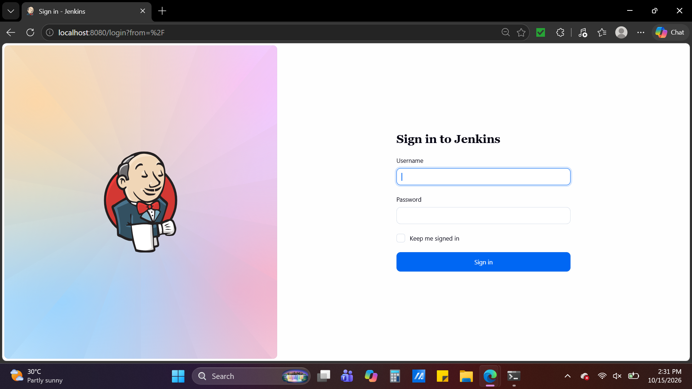
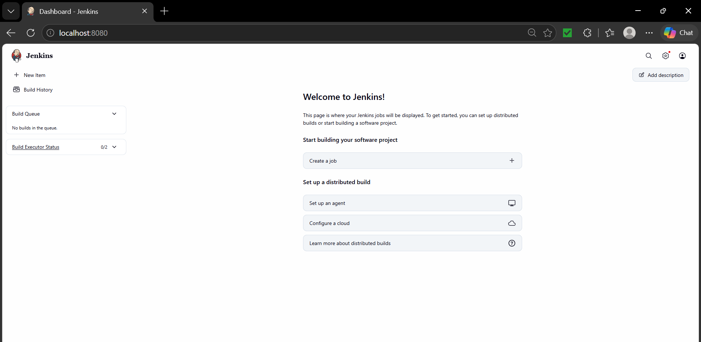
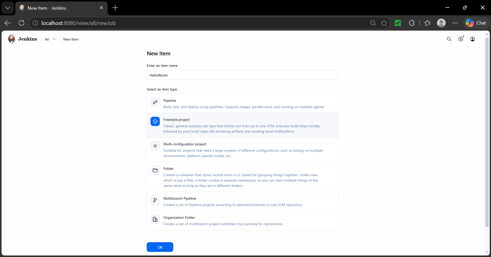
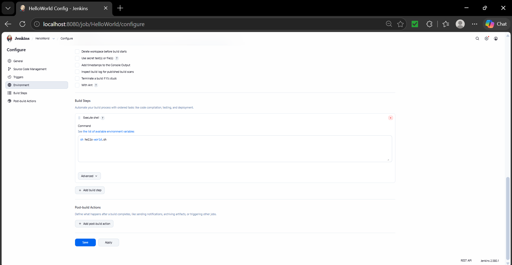
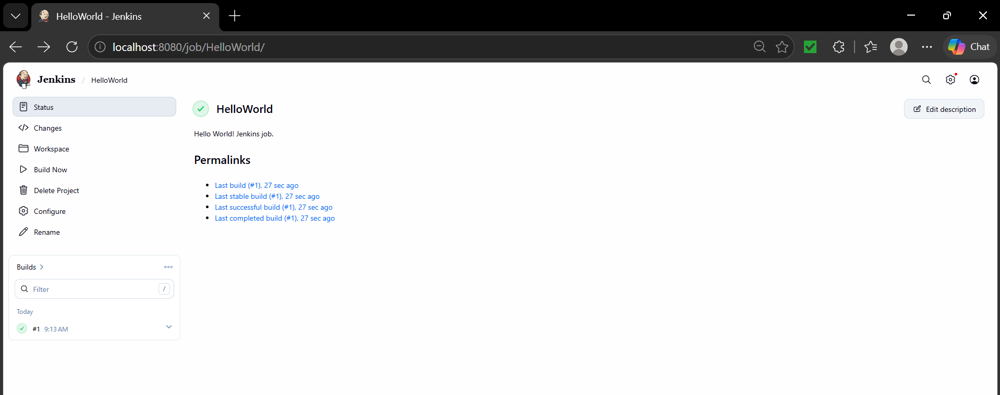
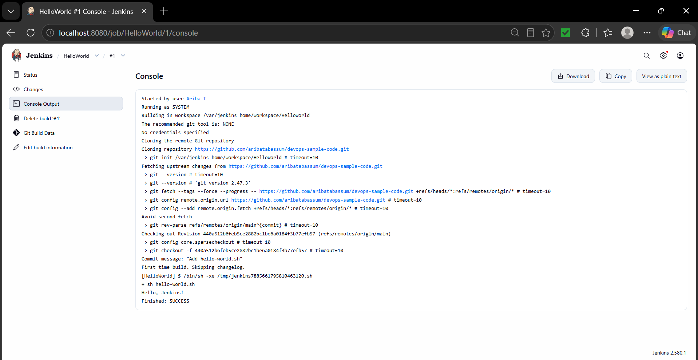

# DevOps Exercise 8: Creating a "Hello World" Jenkins Job

## Objective

Create a simple shell script (`hello-world.sh`), host it in a public GitHub repository, and configure a **Jenkins Freestyle job** that pulls the script from GitHub and executes it, verifying the result through the build's console output.

## Steps Performed

### 1. Created the script locally

In the WSL (Ubuntu) terminal, created a working directory `devops-sample-code`, created the file `hello-world.sh` with `touch`, and opened it in `nano` to write the script.

### 2. Configured Git, made the script executable and staged it

Set the global Git username and email, then verified the script contents with `cat hello-world.sh` (a `#!/bin/bash` shebang and `echo "Hello, Jenkins!"`). Made it executable with `chmod +x hello-world.sh`, initialised the repository (`git init`), staged the file (`git add hello-world.sh`) and ran `git status`, which showed `hello-world.sh` as a new file ready to be committed.

### 3. Committed and pushed to GitHub

Committed the script (`git commit -m "Add hello-world.sh"`, commit `440a512`, 1 file changed, 2 insertions). Renamed the branch to `main` (`git branch -M main`), linked the local repository to the public GitHub repository `aribatabassum/devops-sample-code` (`git remote add origin ...`) and pushed (`git push -u origin main`). Authentication used a **fine-grained personal access token** created for this repository only, with **Contents: Read and write** permission. The push created the `main` branch on GitHub and set up tracking.

### 4. Verified the script on GitHub

Opened the `devops-sample-code` repository on GitHub and confirmed `hello-world.sh` was present on the `main` branch, with the commit message "Add hello-world.sh" and the correct 2-line contents.

### 5. Started Jenkins and logged in

Jenkins was running in Docker from the previous exercise (container `jenkins`, image `jenkins/jenkins:lts`). The container had stopped, so it was restarted with `docker start jenkins` and confirmed running with `docker ps` (ports 8080 and 50000 mapped). Opened `http://localhost:8080` and reached the Jenkins sign-in page.

### 6. Jenkins dashboard

Signed in and landed on the Jenkins dashboard, ready to create a new job.

### 7. Created the HelloWorld Freestyle project

Clicked **New Item**, entered the name `HelloWorld` and selected the **Freestyle project** type.

Configured the job:
- **Description:** `Hello World! Jenkins job.`
- **Source Code Management:** Git, repository URL `https://github.com/aribatabassum/devops-sample-code.git` (public repo, so no credentials needed), **branch specifier changed from `*/master` to `*/main`** to match the branch pushed to GitHub.
- **Build Step:** *Execute shell* with the command `sh hello-world.sh`.

### 8. Ran the job

Saved the job and clicked **Build Now**. Build **#1** completed successfully, shown by the green check mark on the job page and in Build History, with the description "Hello World! Jenkins job." displayed.

### 9. Verified the build output

Opened build #1 → **Console Output**. The log shows Jenkins cloning `devops-sample-code` from GitHub, checking out commit `440a512` (`refs/remotes/origin/main`, message "Add hello-world.sh"), running the shell step `+ sh hello-world.sh`, printing `Hello, Jenkins!`, and ending with `Finished: SUCCESS`.

## Result

The Jenkins job successfully pulled `hello-world.sh` from the GitHub repository and executed it, printing **"Hello, Jenkins!"**, which confirms the Jenkins to GitHub integration is working end to end.

## Files

- `hello-world.sh`: the script executed by the Jenkins job
- Screenshots `01` to `09` (plus `07b`): proof of each step
