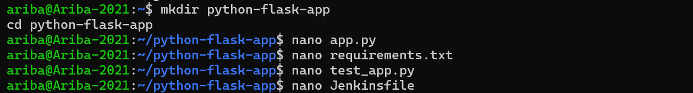
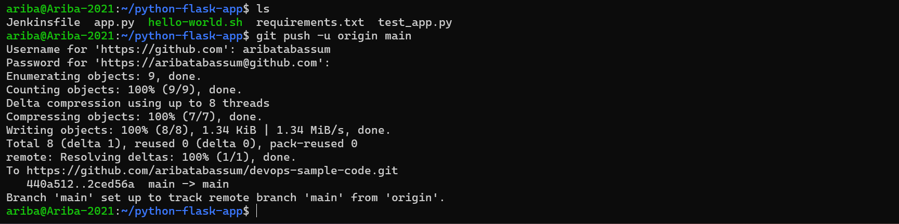
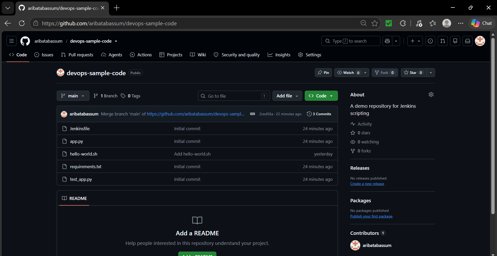
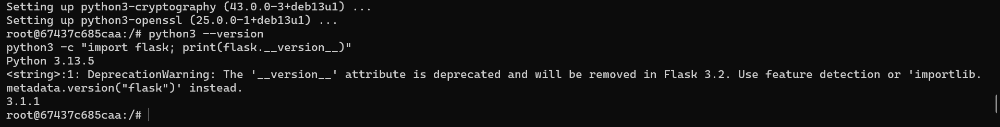
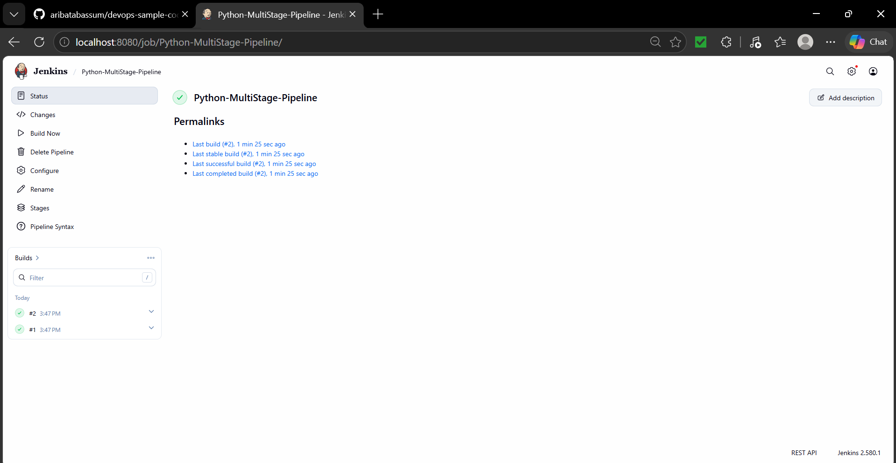
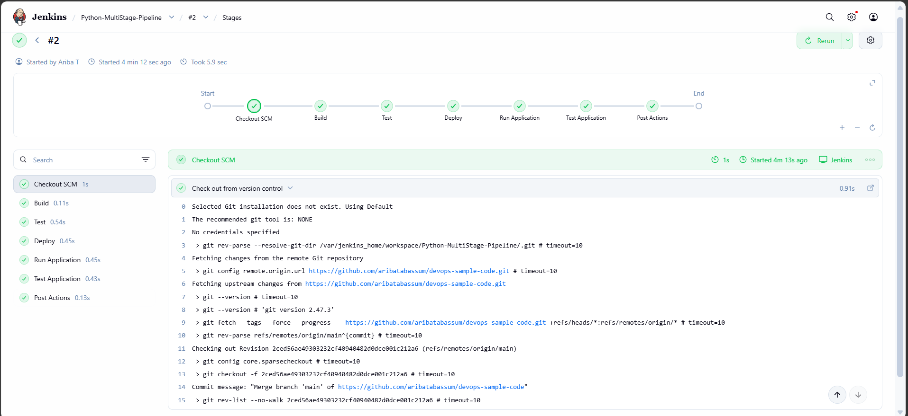
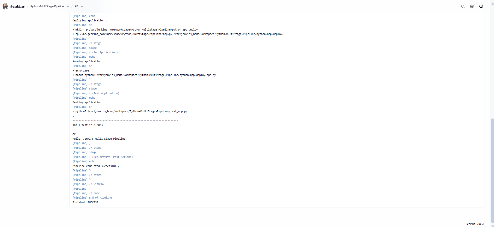

# DevOps Exercise 9: Jenkins Multi-Stage Pipeline for a Python Flask Application

## Objective

Create and run a Jenkins **declarative pipeline** with multiple stages (Build, Test, Deploy, Run Application, Test Application) for a sample Python Flask application. The pipeline is defined in a `Jenkinsfile` stored in a GitHub repository and loaded by Jenkins using **Pipeline script from SCM**.

## Steps Performed

### 1. Created the sample Flask application and Jenkinsfile

Created a project directory `python-flask-app` in WSL (Ubuntu) and wrote four files using `nano`:

- `app.py`: a Flask app with a `/` route that returns "Hello, Jenkins Multi-Stage Pipeline!"
- `requirements.txt`: pins `flask==2.1.2`
- `test_app.py`: a `unittest` test case that checks the home route returns status 200 and the expected message
- `Jenkinsfile`: a declarative pipeline with the stages Build, Test, Deploy, Run Application and Test Application, plus `post` actions for success and failure messages

### 2. Pushed the application to GitHub

Initialized a Git repository and tried to push to my existing `devops-sample-code` repository. The first push was rejected because the remote already contained `hello-world.sh` from Exercise 8. I resolved this by merging the remote history into the local repository (`git pull origin main --allow-unrelated-histories --no-rebase`) and then pushed successfully with `git push -u origin main`.

### 3. Verified the files on GitHub

Opened the `devops-sample-code` repository on GitHub and confirmed that `Jenkinsfile`, `app.py`, `requirements.txt` and `test_app.py` were present alongside the existing `hello-world.sh`.

### 4. Installed Python and Flask inside the Jenkins container

The Jenkins Docker image does not include Python, which would cause the pipeline to fail. I started the stopped `jenkins` container (`docker start jenkins`), opened a root shell inside it (`docker exec -it -u root jenkins bash`) and installed the required packages: `python3`, `pip`, `python3-venv` and `python3-flask`. The container runs a newer Debian release with Python 3.13, so the generic `python3-venv` package was used instead of `python3.11-venv`. Verified the setup with `python3 --version` (Python 3.13.5) and by importing Flask (version 3.1.1).

### 5. Created the Jenkins pipeline job and ran it

In Jenkins, created a new **Pipeline** item named `Python-MultiStage-Pipeline` and set the definition to **Pipeline script from SCM** with Git, the repository URL `https://github.com/aribatabassum/devops-sample-code.git`, branch `*/main` and script path `Jenkinsfile`. Clicked **Build Now**. Builds #1 and #2 both completed successfully.

### 6. Observed the pipeline stages

Opened the build's stage view. Every stage completed successfully: Checkout SCM, Build, Test, Deploy, Run Application, Test Application and Post Actions. The Checkout SCM log shows Jenkins pulling the latest commit (the merge commit) from the GitHub repository.

### 7. Verified the console output

Checked the console output of build #2:

- **Deploy**: created `python-app-deploy` in the workspace and copied `app.py` into it
- **Run Application**: started the app in the background with `nohup python3` and saved its process ID
- **Test Application**: ran `test_app.py`, which reported `Ran 1 test ... OK` and printed "Hello, Jenkins Multi-Stage Pipeline!"
- **Post Actions**: printed "Pipeline completed successfully!"

The build ended with `Finished: SUCCESS`.

## Result

The multi-stage pipeline built, tested, deployed and ran the Flask application automatically from the `Jenkinsfile` in GitHub, with all stages passing.
